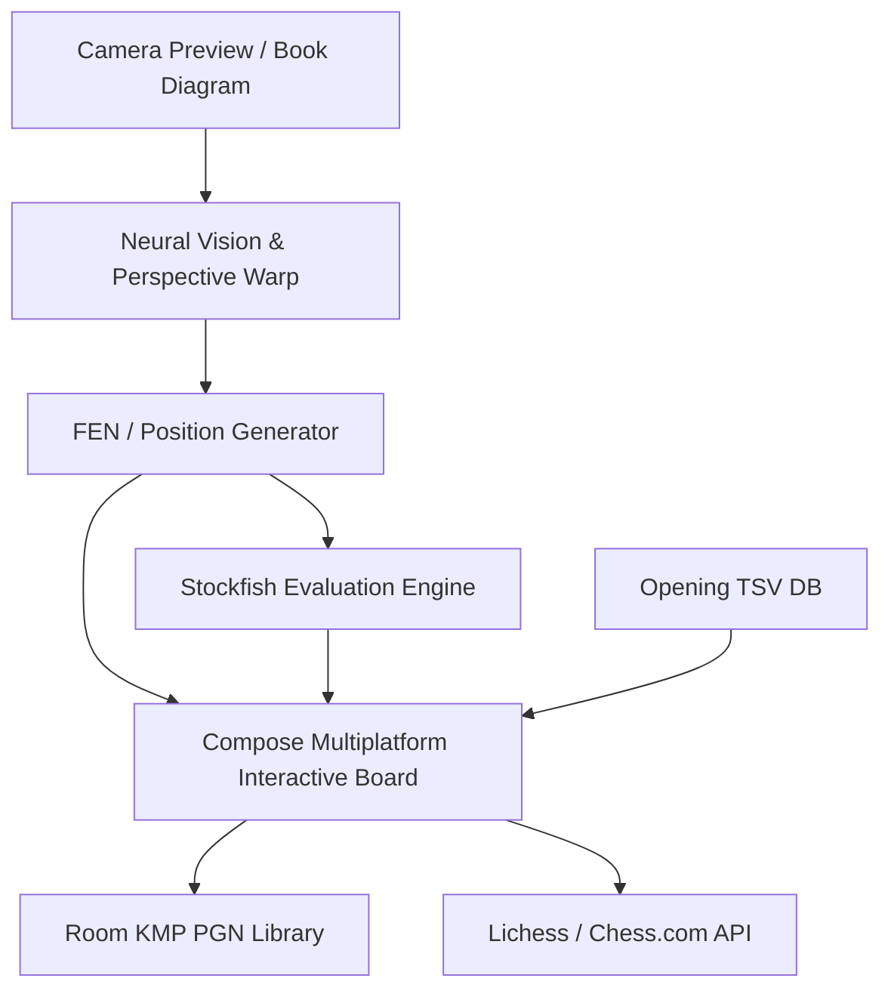

# OmniChess Reader ♟️📸

<p align="center">
  
</p>

<p align="center">
  <b>Instant AI Chessboard Camera Scanner, Neural PGN Digitize & Stockfish Analysis Engine</b>
</p>

<p align="center">
  
  
  
  
  
  
</p>

---

## 🌟 Overview

**OmniChess Reader** bridges physical chess with modern digital chess analysis. By utilizing real-time computer vision and neural diagram recognition, players can point their phone camera at any physical wooden/plastic chessboard, printed chess book, or screen diagram, and convert it instantly into interactive **FEN (Forsyth-Edwards Notation)** and **PGN (Portable Game Notation)**.

Once digitized, positions feed directly into an embedded **Stockfish engine** for live evaluation bars, best move recommendations, opening book lookups, and blunder detection.

---

---

## 📱 App Screenshots

<p align="center">
  <table>
    <tr>
      <td align="center" width="25%">
        <br />
        <b>1. Main Screen</b>
      </td>
      <td align="center" width="25%">
        <br />
        <b>2. Core Experience</b>
      </td>
      <td align="center" width="25%">
        <br />
        <b>3. Interactive Mode</b>
      </td>
      <td align="center" width="25%">
        <br />
        <b>4. Advanced Features</b>
      </td>
    </tr>
    <tr>
      <td align="center" width="25%">
        <br />
        <b>5. Workflow / Details</b>
      </td>
      <td align="center" width="25%">
        <br />
        <b>6. Studio Console</b>
      </td>
      <td align="center" width="25%">
        <br />
        <b>7. Settings & Config</b>
      </td>
      <td align="center" width="25%">
        <br />
        <b>8. Dark & Light Theme</b>
      </td>
    </tr>
  </table>
</p>

---

## ✨ Key Features

- 📸 **Instant Board Recognition**: Ultra-fast camera capture of 2D diagrams and 3D physical boards with perspective warping and corner alignment.
- ♟️ **Piece Classification Neural Net**: Accurate identification of pieces under challenging lighting conditions and varying piece sets.
- ⚡ **Deep Stockfish Evaluation**:
  - Live multithreaded Stockfish evaluation bar.
  - Principal variation lines (best continuation moves).
  - Mistake, inaccuracy, and blunder detection with corrective suggestions.
- 📖 **Opening Book Explorer**: Interactive TSV-backed opening database providing ECO codes, variation names, and win-rate statistics.
- 🌐 **Export & Play Integration**:
  - One-tap export to **Lichess** and **Chess.com**.
  - Local PGN library manager with tag editing and move branching.
- 👥 **Local & Network Relay**: Embedded chess socket relay service for syncing boards across devices during study sessions.

---

## 🏗️ Architecture & Modules

The application is structured into high-performance, modular Kotlin Multiplatform layers:



### Modules:
- `:app`: Android, iOS, and Desktop entry points, CameraX integrations, and platform lifecycle hooks.
- `:chess-engine`: Stockfish communication protocols, UCI command pipeline, and evaluation algorithms.
- `:chess-reader`: Neural OCR, contour detection, square grid segmentation, and piece classifier.
- `:chess-shared`: Core chess rules, legal move validator, FEN parser, PGN serialization, and Compose UI boards.
- `:core`: Dependency injection via Koin, persistence with Room KMP, and network clients.

---

## 📂 Project Structure

```text
OmniChessReader/
├── app/                        # Android application runner & CameraX hooks
├── chess-engine/               # UCI Stockfish interface & depth solvers
├── chess-reader/               # Camera perception, diagram & book scanner
├── chess-shared/               # Common KMP UI, board renderers, SVG piece sets
├── core/                       # Koin DI, Room KMP database, network sockets
├── playstore/                  # High-res icon_512.png, feature graphics
└── gradle/                     # Version catalog & build scripts
```

---

## 🚀 Building & Running

### Requirements
- Android Studio Ladybug+ / IntelliJ IDEA
- JDK 17 or JDK 21
- Android NDK (for native engine compilation)

### Commands
```bash
# Build Android APK
./gradlew :app:assembleDebug

# Run Unit & Chess Logic Tests
./gradlew check
```

---


---
## 📄 License
Designed and developed by **CreativeBliss Labs**. All rights reserved.
